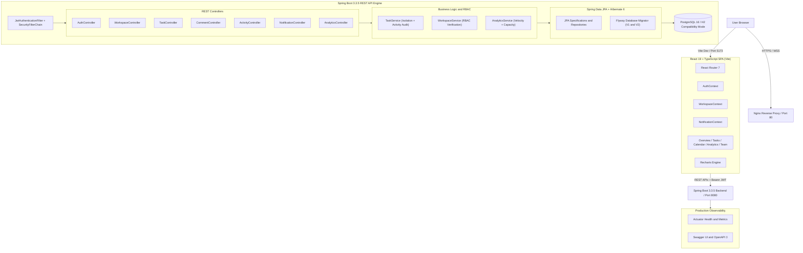
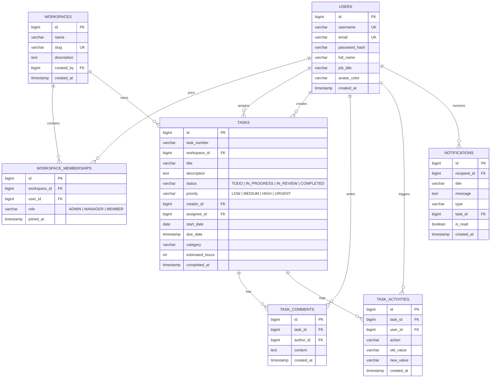

# TASKFORGE — Team Operations & Task Management Platform

[](https://github.com/portfolio/taskforge)
[](https://spring.io/projects/spring-boot)
[](https://openjdk.org/)
[](https://react.dev/)
[](https://vitejs.dev/)
[](https://flywaydb.org/)
[](https://www.postgresql.org/)

---

## 1. Overview & Visual Identity

**TASKFORGE** is a complete, production-grade team operations and task management platform engineered for high-velocity software engineering organizations. Designed under the **"Industrial Workflow Studio"** aesthetic, the application delivers a precision-calibrated command center experience that rejects generic software dashboard tropes in favor of decisive typography, high-contrast operational indicators, structured data tables, and live database-backed telemetry.

### Design Tokens & Aesthetic Standards
- **Backgrounds:** Canvas `#F5F5F2` (Warm Industrial Gray), Panel `#FFFFFF`, Sidebar `#242925` (Dense Slate)
- **Primary Accent:** Precision Safety Orange `#F26B38` with soft tint `#FFF0E8`
- **Secondary Structural Accents:** Blueprint Steel `#436B8A`, Assembly Green `#34765B`, Amber Caution `#B77A22`, Hazard Red `#BF4545`
- **Typography:** `Space Grotesk` (Technical display headings), `Inter` (Data-dense UI readability), `JetBrains Mono` (Task identifiers, code, and timestamps)

---

## 2. System Architecture



---

## 3. Core Feature Set

1. **Multi-Workspace Tenancy & Strict Isolation:**
   - Isolated workspaces with distinct URL slugs, member rosters, and independent task numbering (`TF-101`, `TF-102`).
   - Every database query enforces strict server-side workspace boundaries via JPA Specification filters and service-level tenancy validation.
2. **Precision Task Lifecycle Management:**
   - Status pipeline: `TODO` &rarr; `IN_PROGRESS` &rarr; `IN_REVIEW` &rarr; `COMPLETED`.
   - Four-tier priority hierarchy: `LOW`, `MEDIUM`, `HIGH`, `URGENT` with real-time deadline warnings and overdue calculations.
   - Assignment, re-assignment, estimated hours tracking, and category tags.
3. **Automated Audit Activity Stream:**
   - Every state change (creation, assignment, status update, priority change, due date modification) automatically writes an immutable audit record to `task_activities`.
4. **Task Collaboration & Comments:**
   - Threaded task discussion supporting member communication with ISO timestamps and author avatars.
5. **In-App Notification Dispatcher:**
   - Automated event notifications for task assignments, status changes, and workspace invitations with read/unread tracking.
6. **Live Database-Backed Analytics:**
   - Weekly completion velocity area charts, task status distribution, and per-member workload distribution tables computed directly from relational records.
7. **Interactive Operations Calendar:**
   - Comprehensive monthly grid visualizing upcoming milestones, deadlines, and urgency badges.

---

## 4. Database Schema & Entity Relational Design

The relational database architecture is defined and maintained through versioned Flyway migrations (`V1__init_schema.sql` and `V2__seed_demo_data.sql`).



### Strategic Compound Indices
- `idx_tasks_workspace_status`: `(workspace_id, status)` for instant status tab filtering.
- `idx_tasks_workspace_assignee`: `(workspace_id, assignee_id)` for high-speed assignee queues.
- `idx_tasks_workspace_due`: `(workspace_id, due_date)` for fast calendar range queries.
- `idx_memberships_user_ws`: `(user_id, workspace_id)` for sub-millisecond RBAC permission checks.

---

## 5. Security & RBAC Model

Authentication is built on **stateless JSON Web Tokens (JWT)** with HMAC-SHA256 signing and salted **BCrypt** password hashing (10 rounds).

### Role-Based Access Control (RBAC) Matrix

| Capability / Action | ADMIN | MANAGER | MEMBER |
| :--- | :---: | :---: | :---: |
| **Manage Workspace Settings & Delete Workspace** | ✅ | ❌ | ❌ |
| **Invite & Update Member Roles** | ✅ | ❌ | ❌ |
| **Create New Tasks** | ✅ | ✅ | ✅ |
| **Edit Any Task Specifications & Delete Tasks** | ✅ | ✅ | ❌ (Own only) |
| **Reassign Tasks to Other Members** | ✅ | ✅ | ❌ |
| **Update Task Status (`TODO` &rarr; `IN_PROGRESS` etc.)** | ✅ | ✅ | ✅ |
| **Post Comments & Participate in Discussions** | ✅ | ✅ | ✅ |
| **View Analytics & Observability Metrics** | ✅ | ✅ | ✅ |

---

## 6. REST API Catalog

All endpoints require `Authorization: Bearer <token>` (except `/api/auth/*`).

| Method | Endpoint | Description | Query Parameters |
| :--- | :--- | :--- | :--- |
| `POST` | `/api/auth/login` | Authenticate user & issue JWT | N/A |
| `POST` | `/api/auth/register` | Register new account & auto-provision primary workspace | N/A |
| `GET` | `/api/users/me` | Fetch authenticated user profile & preferences | N/A |
| `GET` | `/api/workspaces` | List all workspaces where current user is a member | N/A |
| `POST` | `/api/workspaces` | Create new workspace (creator becomes ADMIN) | N/A |
| `GET` | `/api/workspaces/{id}/members` | List members with roles and active workload stats | N/A |
| `GET` | `/api/tasks` | Query tasks with multi-field search and pagination | `workspaceId`, `status`, `priority`, `assigneeId`, `search`, `page`, `size`, `sort` |
| `POST` | `/api/tasks` | Create new task within workspace | Request Body |
| `GET` | `/api/tasks/{id}` | Fetch detailed task specifications by ID | `workspaceId` |
| `PATCH` | `/api/tasks/{id}` | Update task title, description, priority, or deadline | `workspaceId` |
| `PATCH` | `/api/tasks/{id}/status` | Transition task status (triggers audit & notification) | `workspaceId` |
| `DELETE` | `/api/tasks/{id}` | Delete task (requires ADMIN or MANAGER role) | `workspaceId` |
| `GET` | `/api/tasks/{id}/comments` | Chronological discussion thread for task | `workspaceId` |
| `POST` | `/api/tasks/{id}/comments` | Post comment on task | `workspaceId` |
| `GET` | `/api/tasks/{id}/activities` | Audit trail history for specific task | `workspaceId` |
| `GET` | `/api/analytics/dashboard` | Executive KPI overview metrics | `workspaceId` |
| `GET` | `/api/analytics/overview` | Productivity metrics, weekly velocity & member capacity | `workspaceId` |
| `GET` | `/api/notifications` | In-app user notifications | `unreadOnly` |
| `PATCH` | `/api/notifications/{id}/read`| Mark single notification as read | N/A |

---

## 7. Default Demo Accounts

The database comes pre-seeded with 4 distinct team personas for instant evaluation:

| Username | Full Name | Job Title & Role | Default Password |
| :--- | :--- | :--- | :--- |
| `alex.turner` | Alex Turner | Lead Architect & Workspace Admin | `password123` |
| `elena.rostova` | Elena Rostova | Senior Operations Manager | `password123` |
| `marcus.vance` | Marcus Vance | DevOps & Site Reliability Engineer | `password123` |
| `sophia.chen` | Sophia Chen | QA Automation & Systems Engineer | `password123` |

---

## 8. Quickstart & Local Setup

### Option A: Local Development (Zero Cloud / No Docker Required)

The project includes an automatic development fallback to H2 in PostgreSQL compatibility mode (`application-dev.properties`), allowing instant compilation, execution, and test runs on any developer workstation.

1. **Run Backend Service:**
   ```bash
   cd backend
   mvn spring-boot:run
   ```
   *Backend starts on `http://localhost:8080` with H2 console at `/h2-console` and Swagger UI at `/swagger-ui.html`.*

2. **Run Frontend Application:**
   ```bash
   cd frontend
   npm install
   npm run dev
   ```
   *Frontend starts on `http://localhost:5173` with Vite proxy forwarding `/api` requests to port 8080.*

---

### Option B: Production Container Deployment (Docker Compose)

Run the entire stack with PostgreSQL 16, Spring Boot backend, and Nginx reverse proxy:

```bash
docker-compose up --build -d
```

- **Web Application:** `http://localhost` (Port 80)
- **Direct API & Actuator:** `http://localhost:8080/actuator/health`
- **Interactive Swagger Docs:** `http://localhost:8080/swagger-ui.html`

---

## 9. Verification & Test Suite

### Backend Unit & Integration Tests (Maven Surefire)
```bash
cd backend
mvn clean test
```
- **14 Spring Boot tests** covering `AuthService`, `TaskService`, `WorkspaceService`, `AnalyticsService`, and Spring context bootstrap pass with **0 failures, 0 errors**.

### Frontend Unit & Component Tests (Vitest)
```bash
cd frontend
npm test
```
- **13 Vitest unit tests** covering `StatusBadge`, `PriorityBadge`, `UserAvatar`, `Wordmark`, `Login` authentication flow, and task date/priority filtering logic pass with **0 failures**.

### End-to-End API Integration Script
```bash
node backend/e2e-verify.js
```
- Validates the complete chain: login &rarr; JWT token acquisition &rarr; workspace tenancy discovery &rarr; task creation (`#TF-111`) &rarr; comment discussion posting &rarr; status lifecycle transition (`TODO` &rarr; `IN_PROGRESS`) &rarr; multi-parameter search & query &rarr; real-time analytics aggregation.

---

## 10. Engineering Transparency & Environment Notes

- **Host Environment:** Developed and tested on Windows 11 with OpenJDK 25 LTS host compiler and Node.js v24.
- **Bytecode Baseline:** Backend compiles with target bytecode **Java 17** (`<java.version>17</java.version>`) for universal deployment compatibility across all cloud providers and container engines.
- **Database Dialect Compatibility:** Flyway migrations utilize standard ANSI SQL and ISO-8601 timestamp literals, enabling deterministic schema creation across both local H2 PostgreSQL compatibility mode and production PostgreSQL 16 instances.
"# Smart-Task-Management-Platform" 
